

<h1 align="center">Lookout</h1>

<b>Private, offline apps for Windows</b> Ten apps for documents and media · One launcher · No accounts · No subscriptions · No tracking

---

Lookout is a family of small desktop apps that do the jobs people usually pay a subscription for: reading and signing PDFs, drawing diagrams, planning projects, editing video and audio. They share one clean dark look inspired by Google's own tools, they all work without an internet connection, and your files never leave your computer.

## Why Lookout

- **Free and open.** MIT licensed. No trial, no watermark, no upsell.
- **Yours.** No account to create. Nothing is uploaded. Nothing is tracked.
- **Offline.** Every app works with the network switched off. The launcher is the only piece that goes online, only to find and download releases.
- **Familiar.** One dark charcoal interface with soft rounded buttons and a blue accent, the same shortcuts and layout from app to app. Each app has its own colour logo so you can tell them apart at a glance.
- **Safe.** Apps run in locked-down windows and can reach only the files you choose in the Windows file dialogs.

## In plain words

Lookout is not one program but a **set of ten small programs** that you install on a Windows computer. Each one does a single job well: one reads PDFs, one draws diagrams, one edits video, and so on. You can install only the ones you need.

- The **document apps** (PDFout, Chartout, Branchout, Planout, Frameout) work with pages, drawings and plans.
- The **media apps** (Cutout, Shiftout, Castout, Mendout, Tuneout) work with video, audio and pictures. They carry their own copy of the video tool FFmpeg, so there is nothing extra to set up.
- The **launcher** (Lookout) is an optional app library that installs and updates all of them from one window.

Everything runs on your own computer. Your files are never uploaded, and the apps work with the internet switched off.

## The apps at a glance

| | App | What it is for | Code |
| --- | --- | --- | --- |
|  | **Lookout** (launcher) | Install, open and update all the apps below | [GitHub](https://github.com/plawanpawin-byte/lookout-launcher) |
|  | **PDFout** | Read, annotate and sign PDFs | [GitHub](https://github.com/plawanpawin-byte/pdfout) |
| 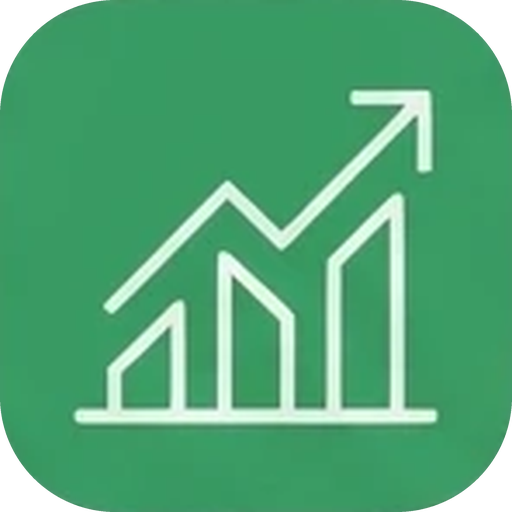 | **Chartout** | Flowcharts, org charts and diagrams | [GitHub](https://github.com/plawanpawin-byte/chartout) |
|  | **Branchout** | Mind maps and outlines | [GitHub](https://github.com/plawanpawin-byte/branchout) |
| 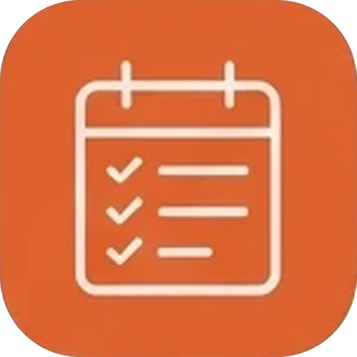 | **Planout** | Project plans and Gantt timelines | [GitHub](https://github.com/plawanpawin-byte/planout) |
| 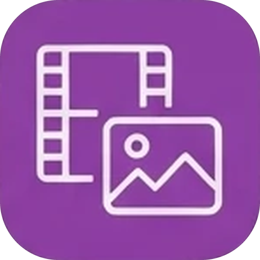 | **Frameout** | App and web screen design with click-through prototypes | [GitHub](https://github.com/plawanpawin-byte/frameout) |
| 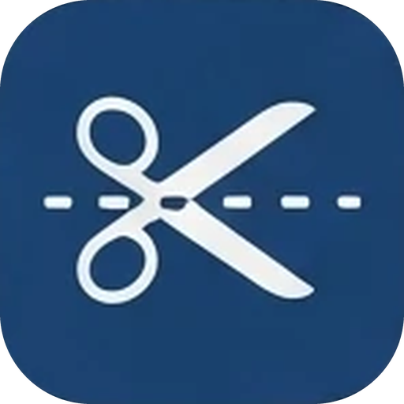 | **Cutout** | Video editing on a timeline | [GitHub](https://github.com/plawanpawin-byte/cutout) |
|  | **Shiftout** | Convert and compress video and audio, make GIFs | [GitHub](https://github.com/plawanpawin-byte/shiftout) |
| 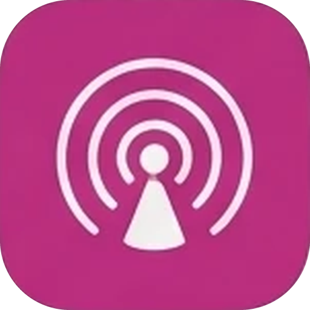 | **Castout** | Record your screen | [GitHub](https://github.com/plawanpawin-byte/castout) |
|  | **Mendout** | Check and repair damaged video, audio, pictures and PDFs | [GitHub](https://github.com/plawanpawin-byte/mendout) |
|  | **Tuneout** | Record and edit audio | [GitHub](https://github.com/plawanpawin-byte/tuneout) |

## Which app do I need?

| I want to... | Use |
| --- | --- |
| Read, mark up, sign or redact a PDF | [PDFout](#pdfout) |
| Draw a flowchart, org chart or process map | [Chartout](#chartout) |
| Brainstorm or outline ideas | [Branchout](#branchout) |
| Plan a project with dates and owners | [Planout](#planout) |
| Sketch app screens and click through them | [Frameout](#frameout) |
| Cut clips together into a video | [Cutout](#cutout) |
| Convert, shrink or turn a video into MP3 or GIF | [Shiftout](#shiftout) |
| Record my screen | [Castout](#castout) |
| Rescue a broken video or audio file | [Mendout](#mendout) |
| Record or edit audio | [Tuneout](#tuneout) |

## Start here: the Lookout launcher

Install, open, update and remove all ten apps from one window. **[Download the launcher](https://github.com/plawanpawin-byte/lookout-launcher/releases/latest)** and press **Install** on any app, or pick the apps you want one by one below.

<b>More launcher screenshots</b>

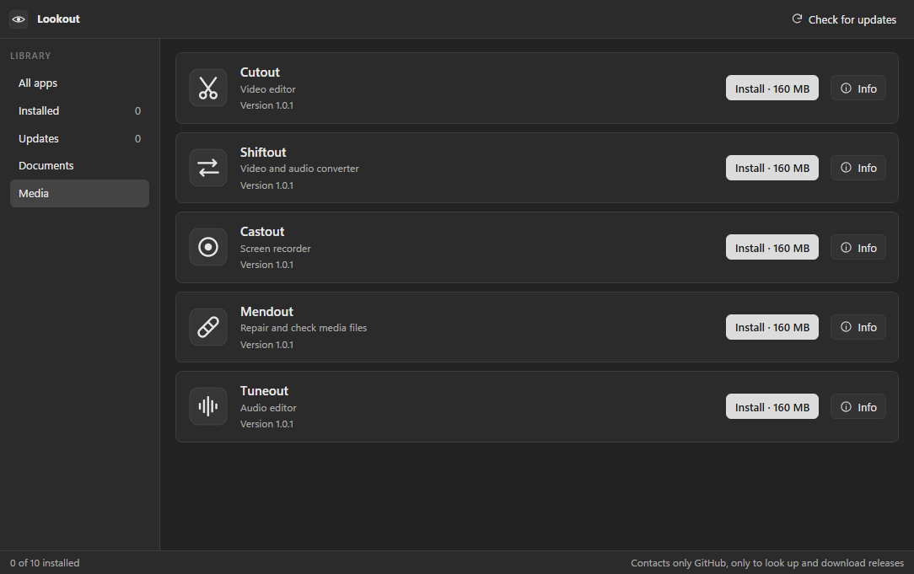

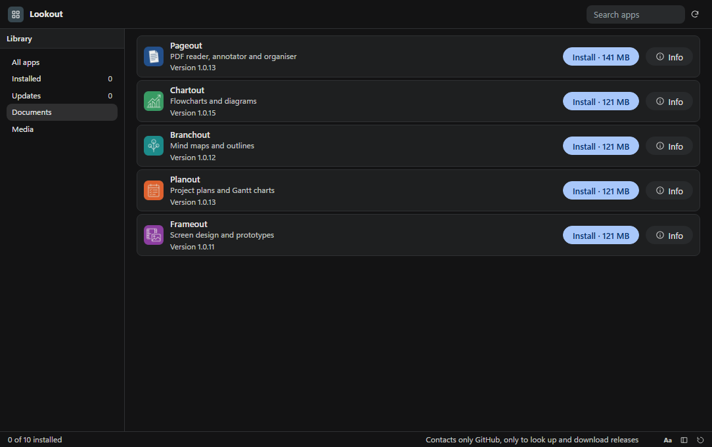

- One-click install, update and removal, with progress
- Downloads are checked against the published checksum before they run
- Installs per user, so no administrator rights are needed
- Nothing is installed or updated without you pressing the button

## Documents

### PDFout

**Read, annotate and sign PDFs.** PDFout is a PDF reader and editor for Windows that works entirely on your computer. Open a document, highlight what matters, write notes, draw, sign, black out private details, rearrange pages and save a new copy.

- **Read:** Continuous page view with a thumbnail strip; Zoom, fit to width and quick jumps between pages; Search text across the whole document with every match highlighted
- **Annotate:** Highlighter, free text, rectangle box and freehand pen; Seven ink colours and an adjustable line thickness; Eraser to remove a single mark
- **Sign:** Draw your signature with a mouse, pen or touch screen and place it anywhere on a page; Resize the signature to fit the line; Sign digitally with a certificate and check who signed a file
- **Organise:** Crop, change the paper size, insert pages, split into files, drag thumbnails, bookmarks and a contents page
- **Protect:** Redact words or personal details by pattern, clean hidden information, password
- **Convert:** Word with tables and pictures, Markdown, web page, CSV tables, PDF/A archive copy, batch jobs
- **Also:** Compare two PDFs, search many files at once, and a full Thai interface (button at the top right)

<b>All 21 screenshots</b>

**The home screen.** PDFout opens on a start screen with quick tools, your recent files and a starred tab.

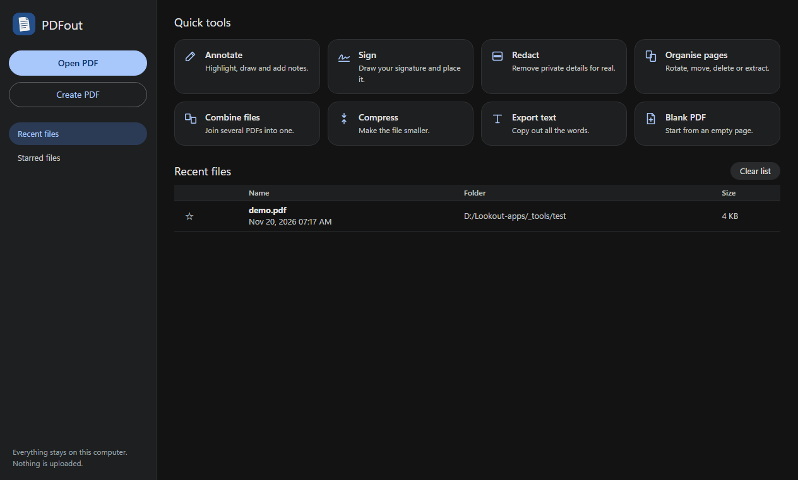

**Reading a PDF.** Pages open in a continuous view with a thumbnail strip on the left and document details on the right. Zoom in and out, fit the page to the window, or search for words across the whole document.

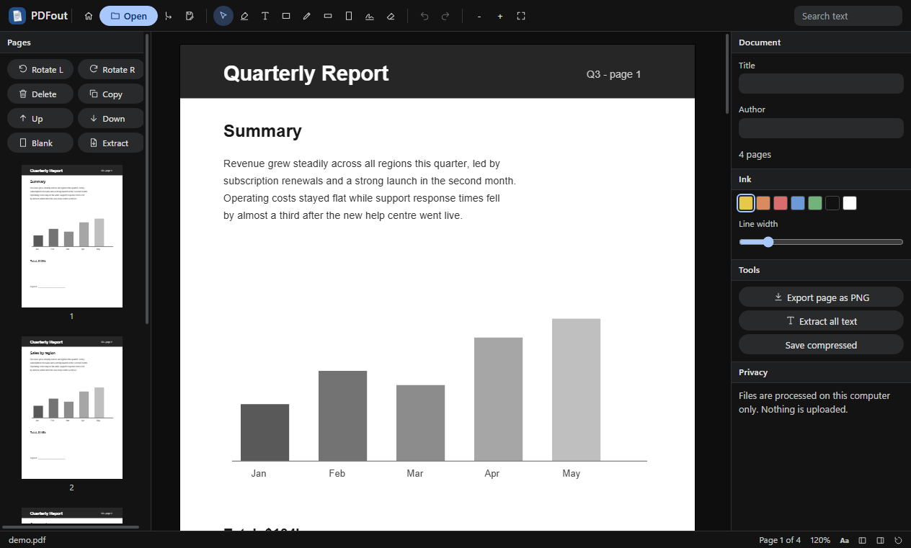

**Marking up a page.** A highlighter over a key sentence, a black redaction bar over a private line, a pen scribble and a box around the chart. Every mark can be moved, erased or undone.

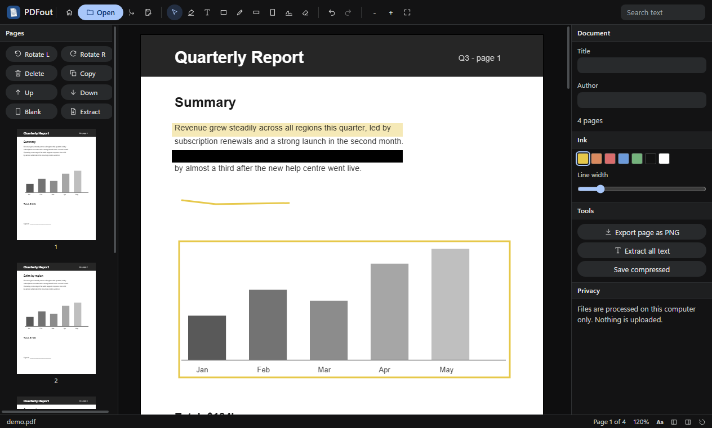

**Organising pages.** Select pages in the thumbnail strip, then rotate, copy, move, delete, insert a blank page or extract them into a new file.

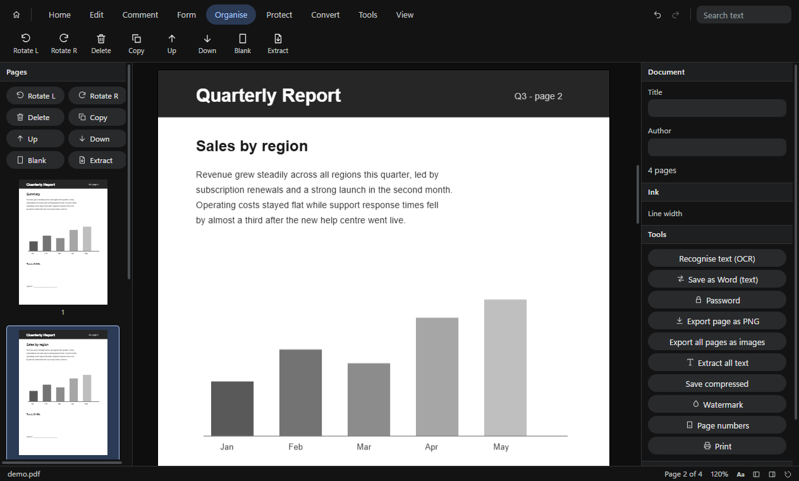

**Fit to width.** One click scales the page to the window so long documents are comfortable to read.

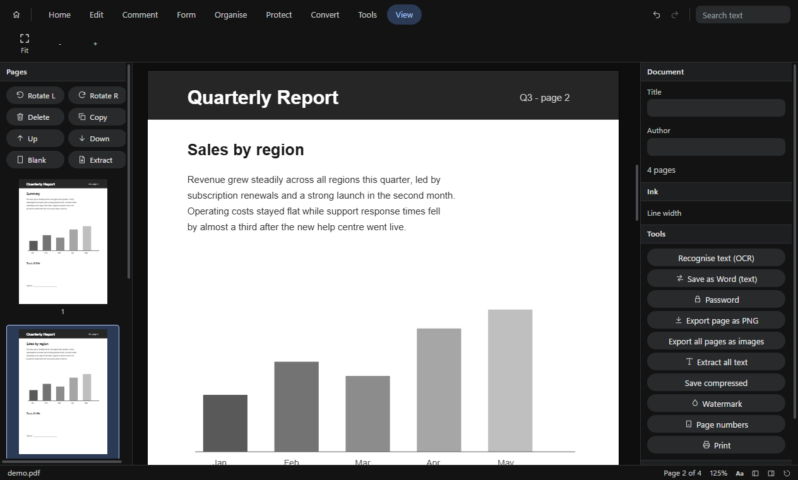

**What you get out.** The current page exported as a sharp PNG image, ready to drop into a slide, a message or another document.

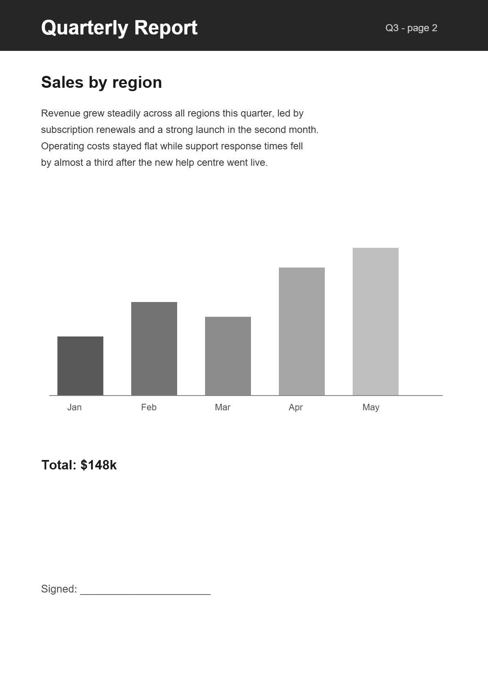

**Edit text.** Choose Edit > Edit text, click any line of a normal PDF and change or delete it. The new words keep the original size, colour and bold; the old words are hidden under a patch, or removed for good if you tick the option.

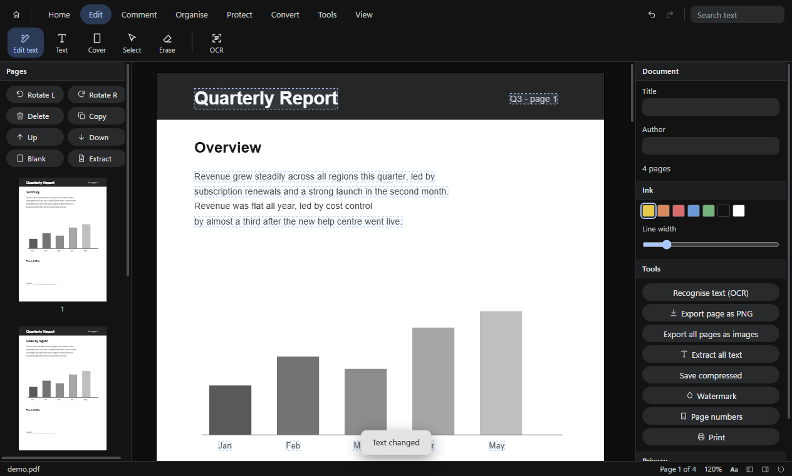

**Form fields.** Open the Form tab, pick Text field, Checkbox or Dropdown and drag a rectangle on the page. They are saved as real fill-in fields that work in any PDF reader.

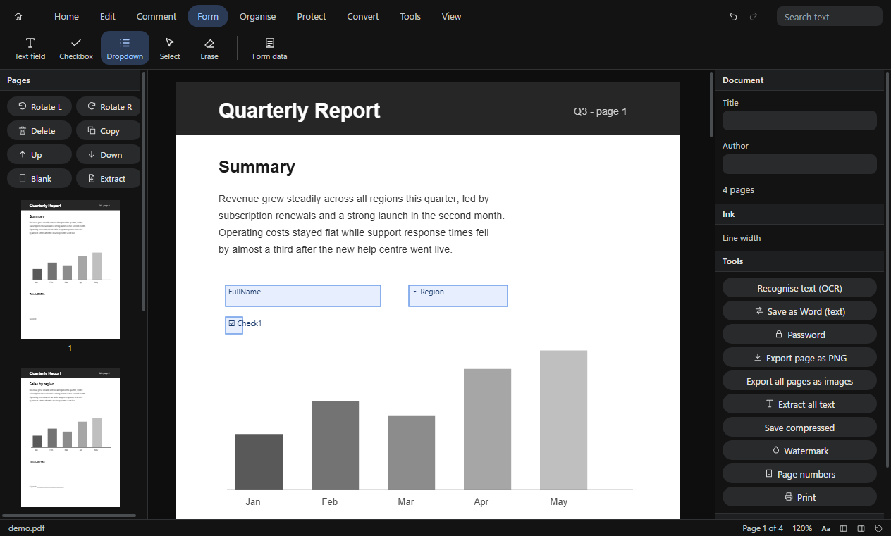

**Password.** Open Protect > Password to lock the saved PDF with a password (256-bit encryption, made on your computer) and choose whether people may print, copy or edit. Locked PDFs ask for their password when opened. Convert > Word saves the document as a Word file with its tables and pictures.

**Crop, bookmarks, compare.** Organise > Crop trims margins; the left panel shows and edits bookmarks; Tools > Compare shows what changed between two PDFs.

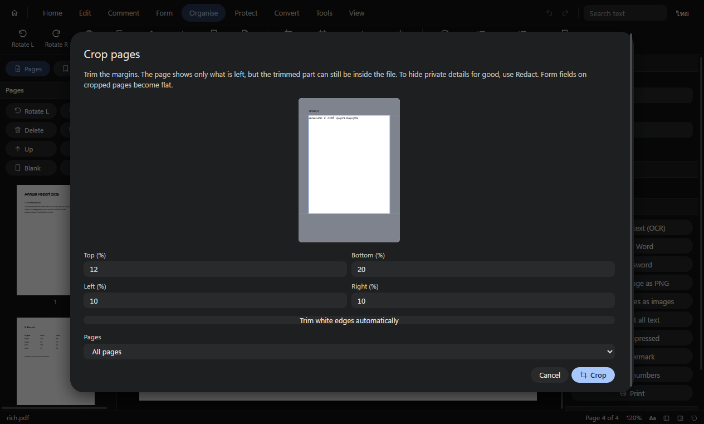

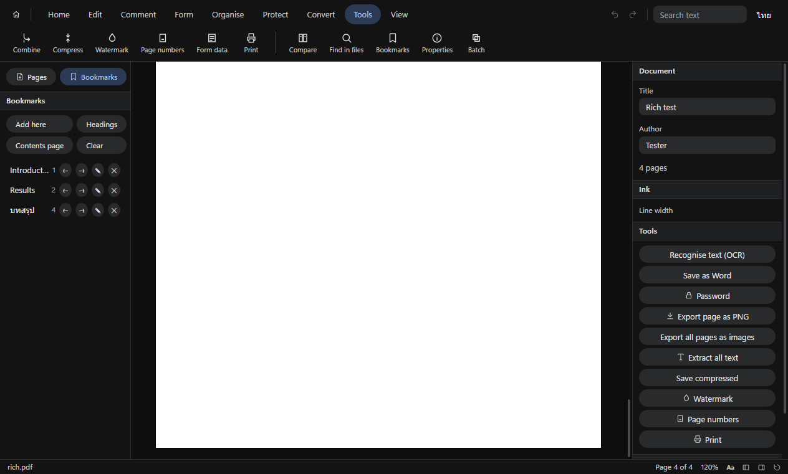

**Protect.** Redact personal details by pattern and sign with a digital signature.

**Thai interface.** One button switches every menu and message between Thai and English.

**Text recognition (OCR).** Open a scan or photo, choose Convert > OCR (English, Thai or both) and PDFout reads the words offline. Copy them, save them as text, keep them as a hidden searchable layer, or turn them into editable text boxes.

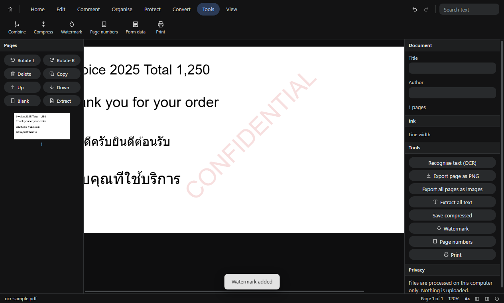

<b>Every feature</b>

**Read**

- Continuous page view with a thumbnail strip
- Zoom, fit to width and quick jumps between pages
- Search text across the whole document with every match highlighted
- Document panel showing the page count, title and author

**Annotate**

- Highlighter, free text, rectangle box and freehand pen
- Seven ink colours and an adjustable line thickness
- Eraser to remove a single mark
- Select, move and resize marks after placing them
- Undo and redo for every change

**Sign**

- Draw your signature with a mouse, pen or touch screen and place it anywhere on a page
- Resize the signature to fit the line

**Redact for real**

- Draw a redaction box over any text or picture you must hide
- Redaction is permanent: when you save, the covered area is flattened into the page, so the hidden words cannot be copied or recovered

**Organise**

- Rotate left or right, delete, copy, move up or down
- Insert blank pages
- Extract the selected pages into a new PDF
- Merge other PDFs into the document you have open

**Export**

- Save a new PDF that includes your marks and changes
- Edit the title and author stored in the file
- Export any page as a PNG image
- Extract all text from the document

**Formats:** Opens PDF files. Saves PDF. Exports a page as PNG and the document text as plain text.

**[Download PDFout](https://github.com/plawanpawin-byte/pdfout/releases/latest)** · [Screenshots and full details](https://github.com/plawanpawin-byte/pdfout)

### Chartout

**Flowcharts and diagrams.** Chartout is a diagram maker for flowcharts, org charts, process maps and quick sketches of how things connect. Drag shapes onto an unlimited canvas, join them with connectors that follow the shapes around, then export a clean PNG or SVG.

- **Shapes:** Process, rounded, decision, data, ellipse, document, database, subprocess, note, actor, cloud, hexagon, triangle, star and free text; Change fill colour, outline, text and size in the properties panel; Bring a shape to the front or send it back
- **Connectors:** Connect any two shapes; the line follows when you move them; Straight or elbow (right-angle) routing; Optional arrowheads, dashed lines and text labels on every connector
- **Arranging:** Select several shapes with a drag box or Shift + click; Align and distribute horizontally or vertically; Copy, paste and duplicate

<b>All 5 screenshots</b>

**A flowchart on the canvas.** Shapes on an unlimited canvas with labelled connectors. The decision diamond branches into Yes and No, and a retry arrow loops back.

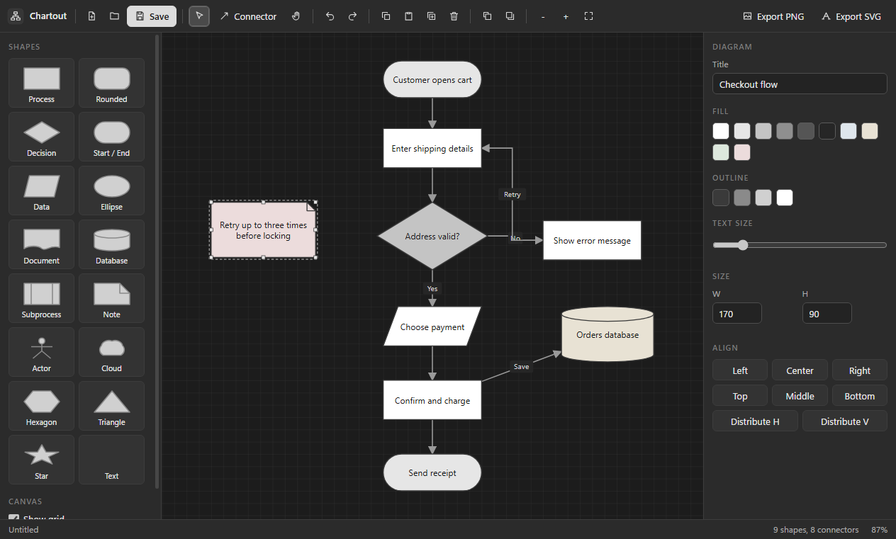

**Shape properties.** Select a shape to change its fill, outline, text and size in the panel on the right.

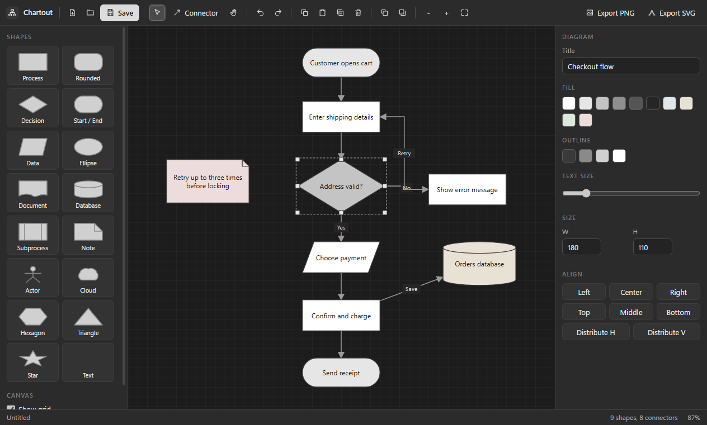

**Select, align and distribute.** Select several shapes and tidy them with the align and distribute buttons so rows and columns line up exactly.

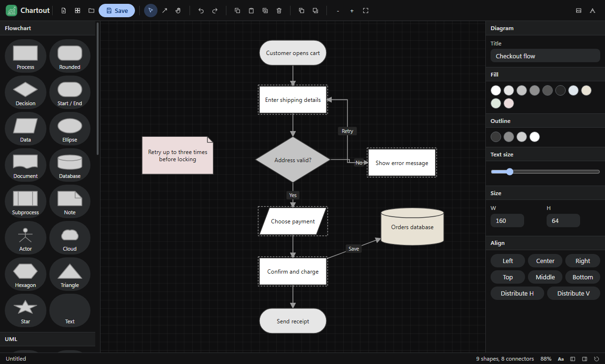

**Exported PNG.** The same chart exported as a high-resolution image with a clean white background.

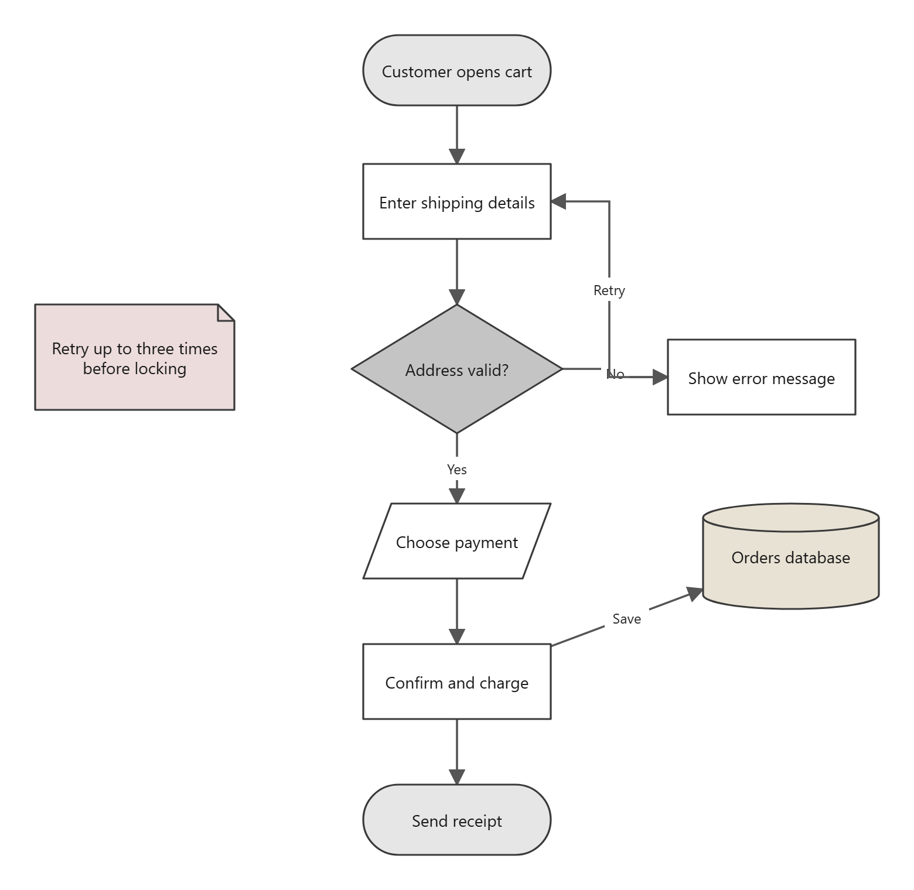

**Another result: an org chart.** Elbow connectors route neatly from parent to child, which makes organisation charts quick to build.

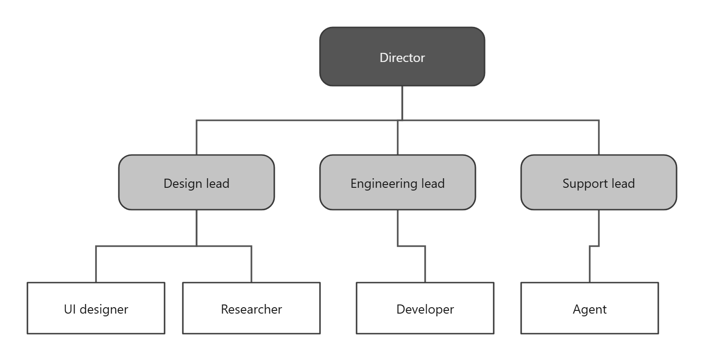

<b>Every feature</b>

**Shapes**

- Process, rounded, decision, data, ellipse, document, database, subprocess, note, actor, cloud, hexagon, triangle, star and free text
- Change fill colour, outline, text and size in the properties panel
- Bring a shape to the front or send it back

**Connectors**

- Connect any two shapes; the line follows when you move them
- Straight or elbow (right-angle) routing
- Optional arrowheads, dashed lines and text labels on every connector

**Arranging**

- Select several shapes with a drag box or Shift + click
- Align and distribute horizontally or vertically
- Copy, paste and duplicate

**Canvas**

- Unlimited canvas with pan, zoom and Fit
- Hand tool, or hold Space and drag to pan
- Undo and redo

**Files and export**

- Save and reopen your diagrams as .chartout files
- Export PNG for documents and slides
- Export SVG for sharp scaling and further editing

**Formats:** Saves .chartout files. Exports PNG and SVG.

**[Download Chartout](https://github.com/plawanpawin-byte/chartout/releases/latest)** · [Screenshots and full details](https://github.com/plawanpawin-byte/chartout)

### Branchout

**Mind maps and outlines.** Branchout is a mind-mapping app. Start with one idea in the centre, branch out with topics and sub-topics, add notes and colour, collapse the parts you are not working on, and turn the whole map into an image or a text outline.

- **Building a map:** Add a child topic or a sibling with a single key; Rename and delete topics; Automatic, balanced layout on both sides of the centre
- **Detail:** Eight soft colours for topics; Notes on any topic; Collapse and expand any branch, or expand everything at once
- **Keyboard first:** Tab adds a child, Enter adds a sibling, F2 edits, Delete removes, Space folds; Arrow keys move the selection around the map

<b>All 5 screenshots</b>

**A mind map.** A central topic with four branches. The layout spreads to both sides automatically as you add topics.

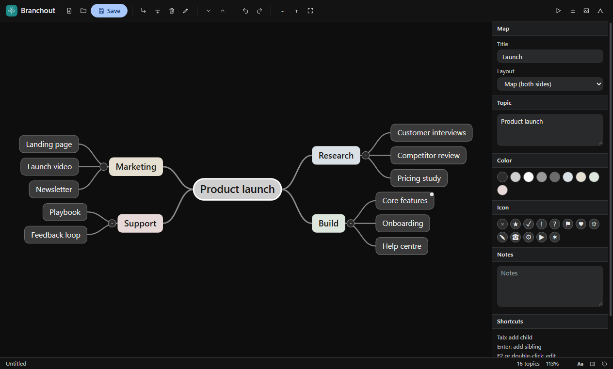

**Topic details.** The side panel edits the selected topic: rename it, pick a soft colour and write notes. A small dot marks topics that carry a note.

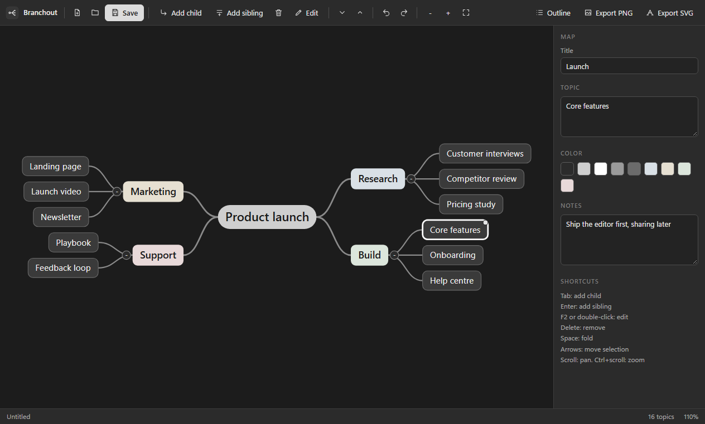

**Collapsed branches.** Fold away branches you are not working on. A plus sign shows that something is hidden underneath.

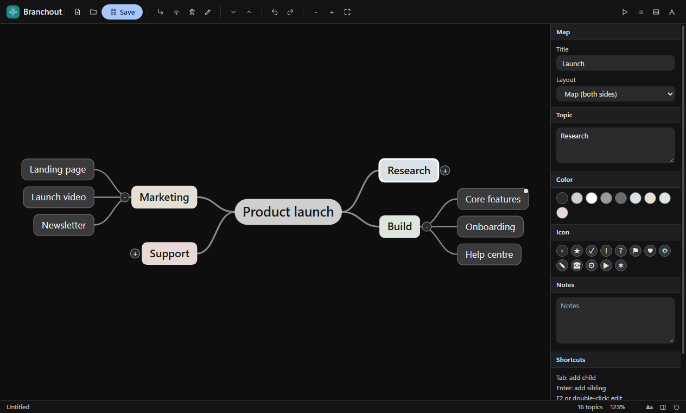

**Exported PNG.** The map exported as a high-resolution image, ready for a document or a slide.

**Outline output.** The same ideas as an indented list you can paste into an email or a document.

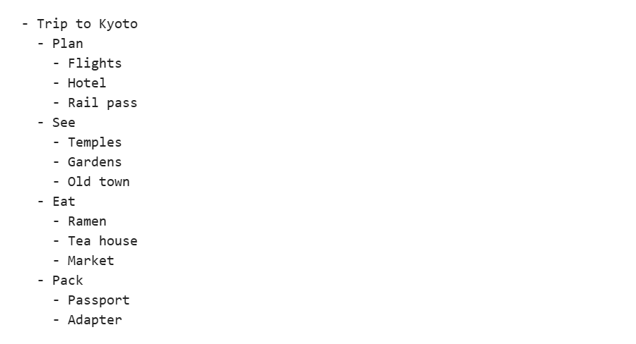

<b>Every feature</b>

**Building a map**

- Add a child topic or a sibling with a single key
- Rename and delete topics
- Automatic, balanced layout on both sides of the centre
- Pan, zoom and Fit to see the whole map

**Detail**

- Eight soft colours for topics
- Notes on any topic
- Collapse and expand any branch, or expand everything at once

**Keyboard first**

- Tab adds a child, Enter adds a sibling, F2 edits, Delete removes, Space folds
- Arrow keys move the selection around the map

**Files and export**

- Save and reopen .branchout files
- Export PNG or SVG
- Export the map as an indented text outline (Markdown)

**Formats:** Saves .branchout files. Exports PNG, SVG and a Markdown or plain text outline.

**[Download Branchout](https://github.com/plawanpawin-byte/branchout/releases/latest)** · [Screenshots and full details](https://github.com/plawanpawin-byte/branchout)

### Planout

**Plans and Gantt timelines.** Planout turns a list of tasks into a project plan. Give each task a start date, a length and an owner, link tasks that depend on each other, and watch the Gantt timeline update.

- **Tasks:** Name, start date, length in days, percent done and owner for every task; Add task or milestone, move tasks up and down, delete; Edit directly in the table
- **Dependencies:** Choose which task each task comes after; Start dates move automatically when an earlier task changes; A link that would create a loop is refused
- **Timeline:** Gantt chart with a month and day scale and a today marker; Progress bars, milestone diamonds and dependency arrows; Drag a bar to move it, drag its end to change its length

<b>All 5 screenshots</b>

**The plan and its timeline.** A task table on the left and a Gantt chart on the right. A dashed line marks today.

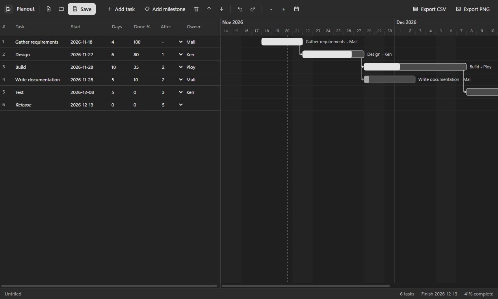

**Selecting a task.** Click a row to highlight it in both the table and the chart. Progress shows as the filled part of each bar.

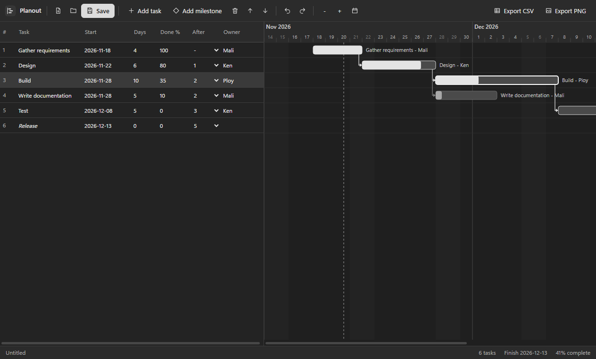

**Dependencies and milestones.** A diamond marks a milestone. Arrows show which task waits for which, and dates follow automatically.

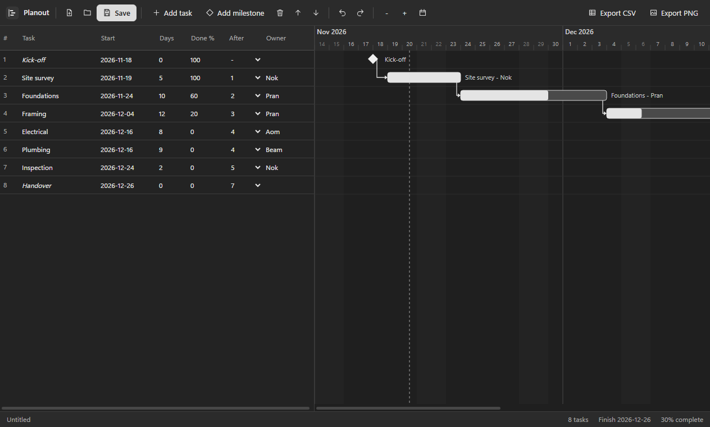

**Exported timeline image.** The chart exported as a PNG for a status report or a slide.

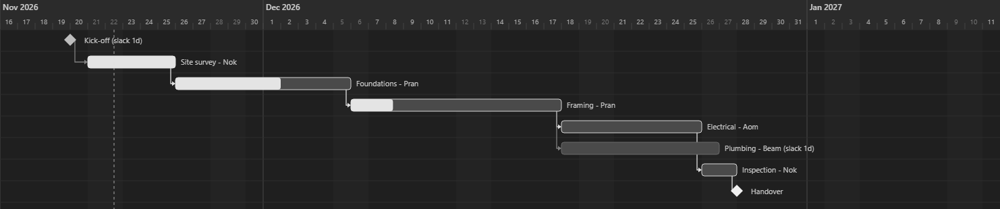

**CSV output.** Task names, dates, durations, progress and owners as a CSV file that opens in any spreadsheet.

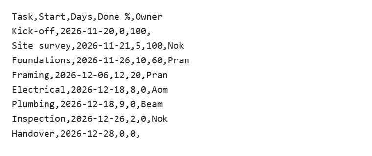

<b>Every feature</b>

**Tasks**

- Name, start date, length in days, percent done and owner for every task
- Add task or milestone, move tasks up and down, delete
- Edit directly in the table

**Dependencies**

- Choose which task each task comes after
- Start dates move automatically when an earlier task changes
- A link that would create a loop is refused

**Timeline**

- Gantt chart with a month and day scale and a today marker
- Progress bars, milestone diamonds and dependency arrows
- Drag a bar to move it, drag its end to change its length
- Zoom in and out, and jump back to today

**Summary**

- The status bar shows the number of tasks, the planned finish date and the overall percent complete

**Files and export**

- Save and reopen .planout files
- Export the timeline as PNG
- Export the task list as CSV

**Formats:** Saves .planout files. Exports PNG and CSV. Dates are written year-month-day, for example 2026-11-24.

**[Download Planout](https://github.com/plawanpawin-byte/planout/releases/latest)** · [Screenshots and full details](https://github.com/plawanpawin-byte/planout)

### Frameout

**Screen design and prototypes.** Frameout is a canvas for designing app screens and web pages. Draw a frame for each screen, fill it with rectangles, circles, lines and text, rearrange layers, then export a screen as an image or an SVG.

- **Drawing:** Frame, rectangle, ellipse, line and text tools; Corner radius, fill, outline width and opacity; Font size for text
- **Layers:** A layer list with names, with hide and lock for each layer; Frames hold the objects placed inside them
- **Prototype:** Give a shape a link to a frame; Preview mode lets you click through your screens like a real app

<b>All 5 screenshots</b>

**Two screens on the canvas.** Frames for a home screen and a detail screen, built from rectangles, circles and text. The layers list on the left names every object.

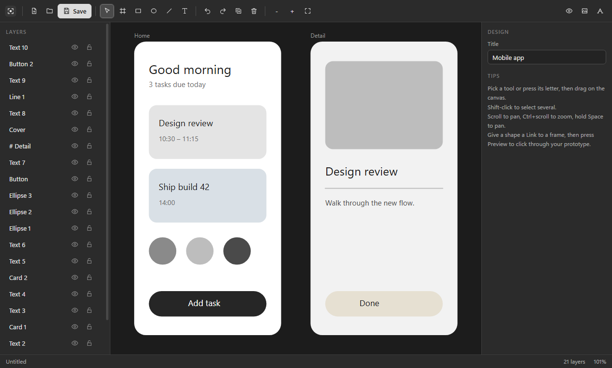

**Layer properties.** Select a layer to change its position, size, corner radius, fill, outline, opacity and text.

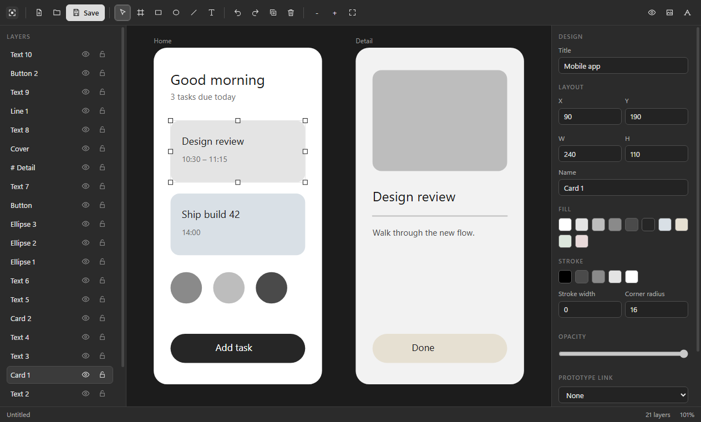

**Selecting several layers.** Shift + click to select more than one layer and move or style them together.

**Exported home screen.** Select a frame and export it as a crisp PNG.

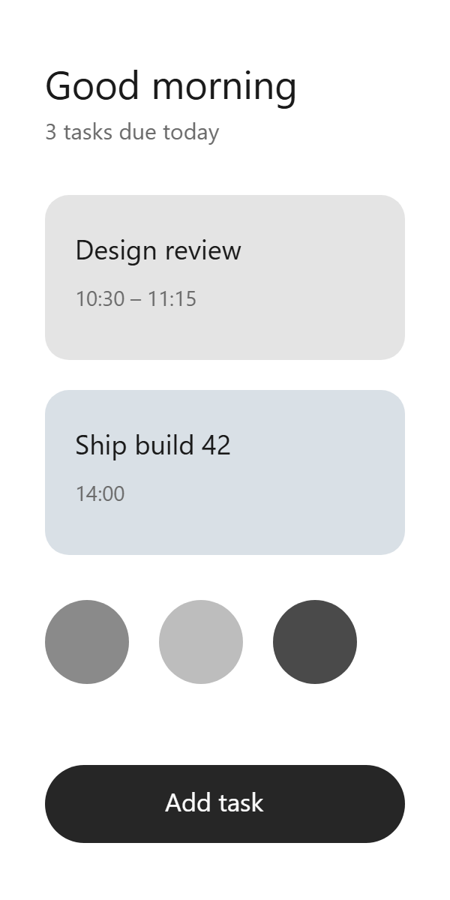

**Exported detail screen.** Each frame exports on its own, so one file can hold a whole app.

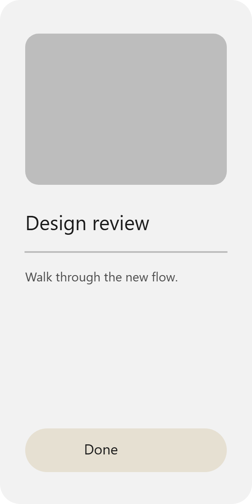

<b>Every feature</b>

**Drawing**

- Frame, rectangle, ellipse, line and text tools
- Corner radius, fill, outline width and opacity
- Font size for text

**Layers**

- A layer list with names, with hide and lock for each layer
- Frames hold the objects placed inside them

**Prototype**

- Give a shape a link to a frame
- Preview mode lets you click through your screens like a real app

**Canvas**

- Infinite canvas with pan, zoom and Fit
- Duplicate, delete, undo and redo

**Files and export**

- Save and reopen .frameout files
- Export the selected frame as PNG
- Export SVG for developers

**Formats:** Saves .frameout files. Exports PNG and SVG.

**[Download Frameout](https://github.com/plawanpawin-byte/frameout/releases/latest)** · [Screenshots and full details](https://github.com/plawanpawin-byte/frameout)

## Media

### Cutout

**Video editing on a timeline.** Cutout is a video editor with a multi-track timeline. Import clips, place them in order, split and trim them, add titles and fades, set the volume and speed of each clip, preview the result and export a finished video.

<a href="https://github.com/plawanpawin-byte/cutout">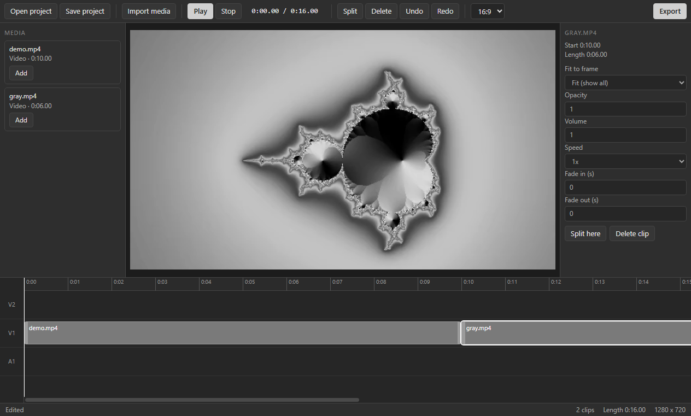</a>

- **Timeline:** Two video tracks and one audio track; Drag to move clips, drag their edges to trim; Split at the playhead, delete, close gaps
- **Clip controls:** Fit or fill the frame; Opacity, volume and playback speed; Fade in and fade out
- **Titles:** Add title text over the picture

<b>All 5 screenshots</b>

**Clips on the timeline.** Two clips side by side on video track 1. The preview shows the frame under the playhead.

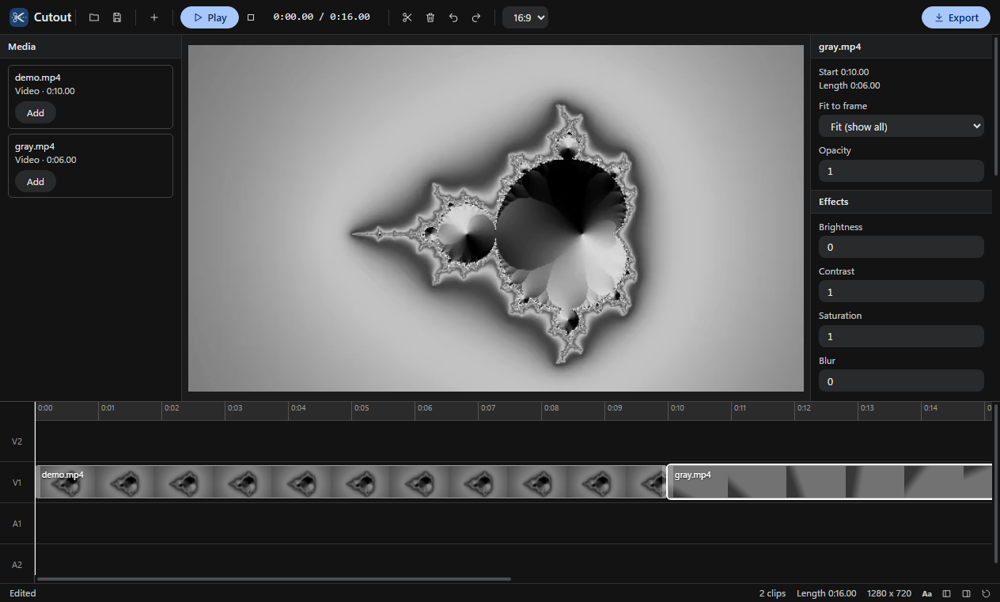

**Clip properties.** Select a clip to set how it fits the frame, its opacity, volume, speed and fades.

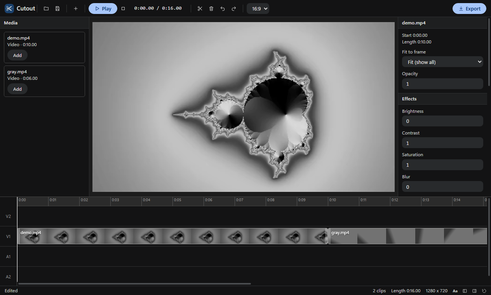

**Splitting a clip.** Press S or Split to cut a clip at the playhead, then trim or delete either half.

**Export options.** Pick a size, a format and a quality level before rendering.

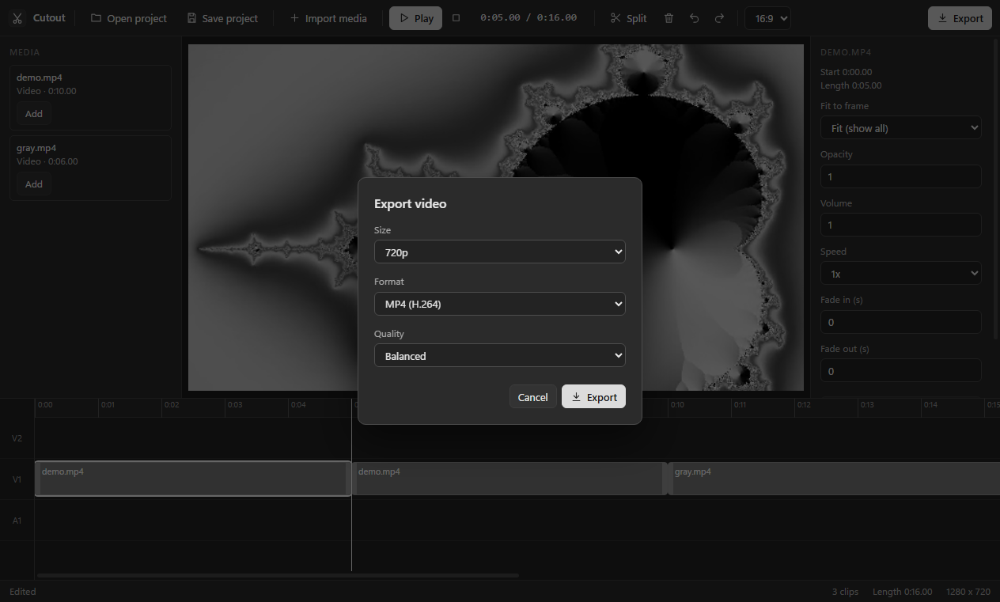

**What you get out.** A frame taken from the exported video file.

<b>Every feature</b>

**Timeline**

- Two video tracks and one audio track
- Drag to move clips, drag their edges to trim
- Split at the playhead, delete, close gaps
- Zoom the timeline with Ctrl + wheel

**Clip controls**

- Fit or fill the frame
- Opacity, volume and playback speed
- Fade in and fade out

**Titles**

- Add title text over the picture

**Projects**

- Save and reopen .cutout projects
- Locate missing files if you moved your media

**Export**

- 480p, 720p or 1080p
- MP4 (H.264), WebM (VP9) or GIF
- Small file, balanced or high quality
- Aspect ratio presets such as 16:9

**Formats:** Imports common video, audio and image files. Exports MP4, WebM and GIF. Projects are .cutout files.

**[Download Cutout](https://github.com/plawanpawin-byte/cutout/releases/latest)** · [Screenshots and full details](https://github.com/plawanpawin-byte/cutout)

### Shiftout

**Convert and compress media.** Shiftout converts video and audio between formats, shrinks large files and makes GIFs. Add as many files as you like, choose a target, and convert them all in one go.

<a href="https://github.com/plawanpawin-byte/shiftout">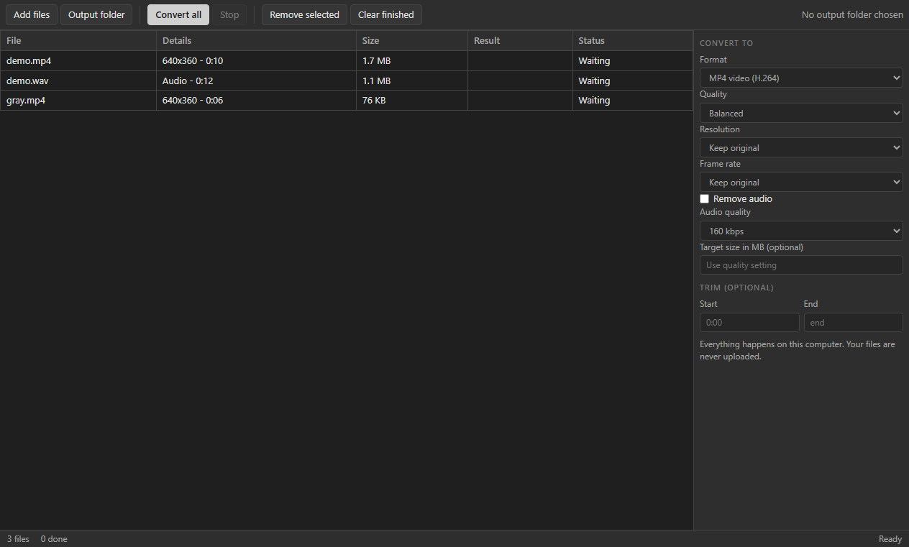</a>

- **Targets:** Video: MP4 (H.264), MKV, MOV and WebM (VP9); Animated GIF; Audio: MP3, AAC (M4A), WAV, FLAC and Opus
- **Settings:** Quality presets; Resolution: keep original, 1080p, 720p, 480p or 360p; Frame rate: keep original, 60, 30, 24 or 15
- **Batch:** Convert many files in one run; Stop at any time; Choose the output folder

<b>All 6 screenshots</b>

**The queue.** Added files with their size, resolution and length. The conversion settings sit in the right panel.

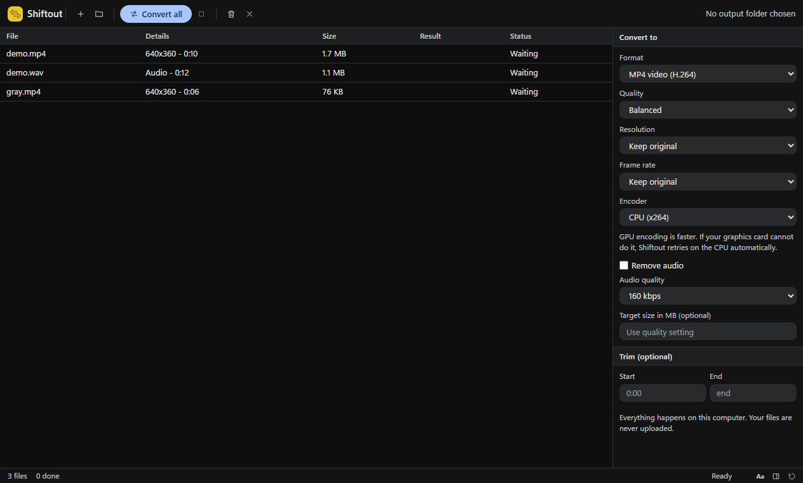

**Choosing a format.** Pick MP4, MKV, MOV, WebM, GIF, MP3, AAC, WAV, FLAC or Opus. The settings change to match.

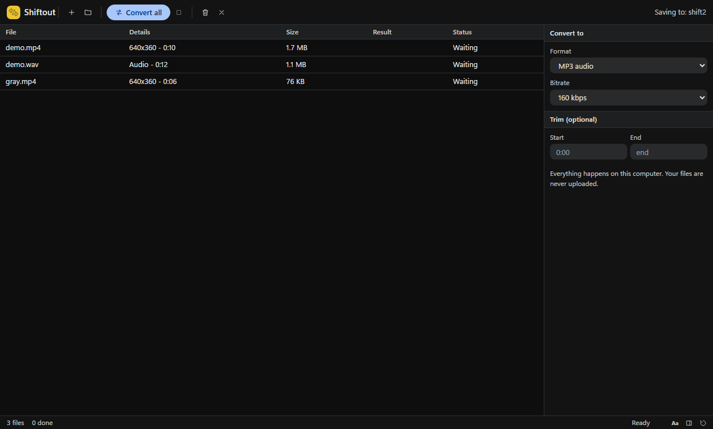

**Batch result.** Every file finished, with the new file name and size. Existing files are never overwritten.

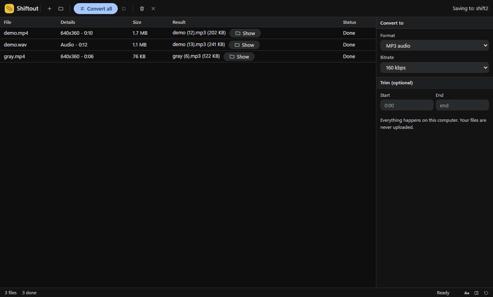

**Making GIFs.** Turn a clip into an animated GIF with a chosen width and frame rate.

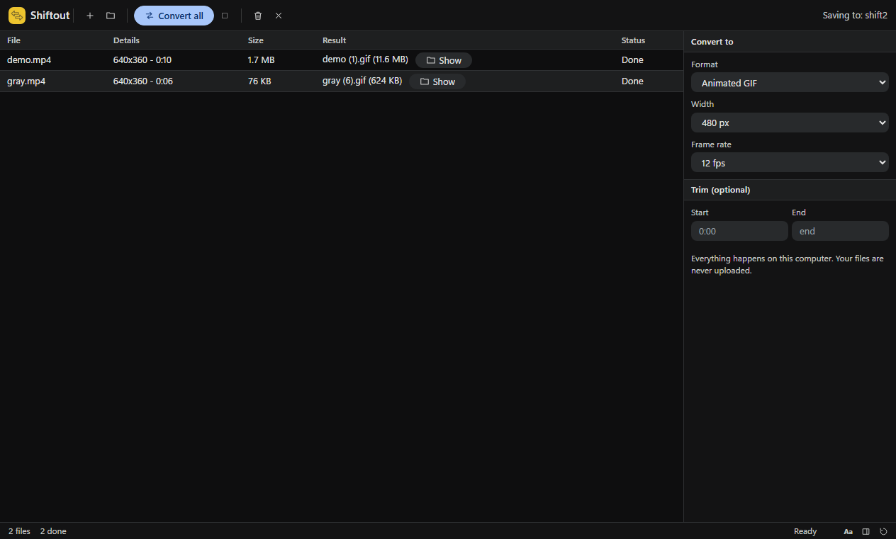

**Output: audio.** The MP3 produced from a video, drawn as a spectrogram.

**Output: GIF.** A frame from the animated GIF made from the clip.

<b>Every feature</b>

**Targets**

- Video: MP4 (H.264), MKV, MOV and WebM (VP9)
- Animated GIF
- Audio: MP3, AAC (M4A), WAV, FLAC and Opus

**Settings**

- Quality presets
- Resolution: keep original, 1080p, 720p, 480p or 360p
- Frame rate: keep original, 60, 30, 24 or 15
- Remove the audio track, or choose its bitrate
- Aim for a target file size in MB
- Trim with start and end times

**Batch**

- Convert many files in one run
- Stop at any time
- Choose the output folder
- Show the finished file in its folder

**Formats:** Reads almost any common video or audio file. Writes the formats listed above.

**[Download Shiftout](https://github.com/plawanpawin-byte/shiftout/releases/latest)** · [Screenshots and full details](https://github.com/plawanpawin-byte/shiftout)

### Castout

**Record your screen.** Castout records your screen or a single window, with computer sound and an optional microphone. Choose what to capture, press start after a short countdown, then review the clip and save it as WebM, MP4, GIF or MP3.

- **Capture:** Any screen or any window; Computer sound and microphone, mixed together; Frame rates from 15 up to 60
- **Control:** Countdown before recording starts; Pause and resume; Stop and review
- **Save:** WebM (fastest, no conversion); MP4 for playing anywhere; GIF (first 30 seconds)

<b>All 6 screenshots</b>

**Choose what to record.** Pick a whole screen or a single window. The thumbnails on this page are placeholders made for the picture; in the app you see live previews.

**Options.** Computer sound, microphone, frame rate, quality, mouse pointer and a start countdown.

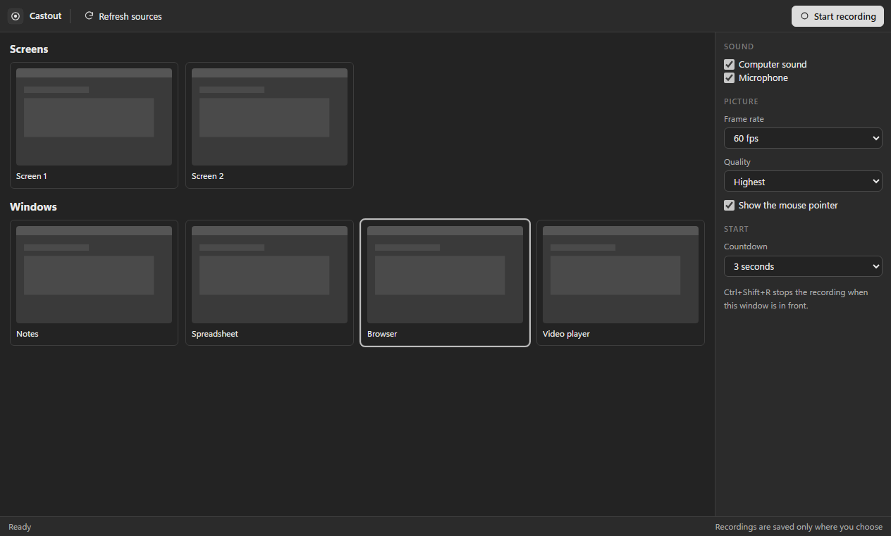

**Recording.** A running timer with Pause and Stop. Press Ctrl + Shift + R to stop while Castout is in front.

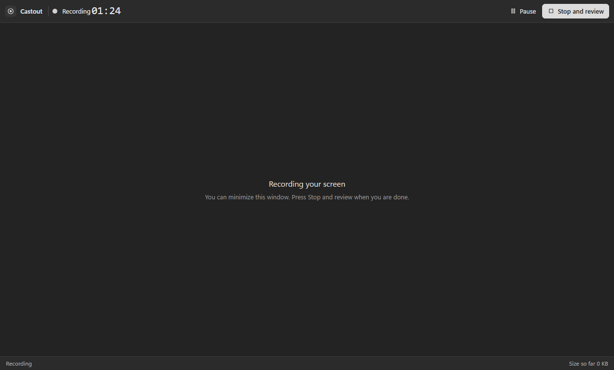

**Review and save.** Play the take back and choose a format.

**Saved.** The file is written only where you choose.

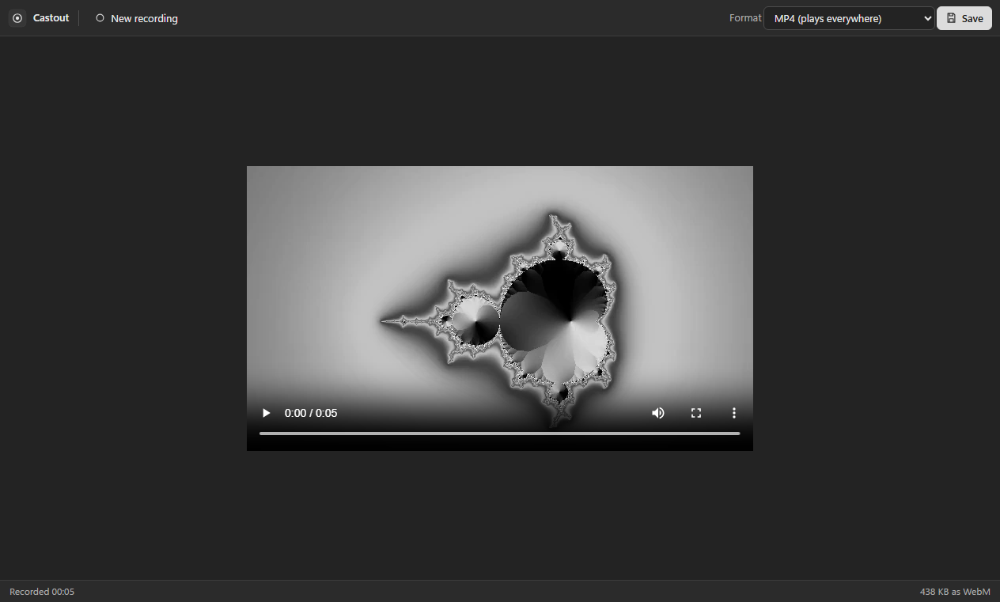

**Output.** A frame from the saved MP4.

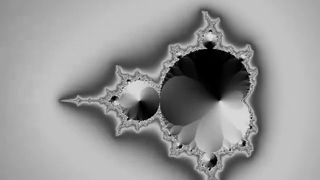

<b>Every feature</b>

**Capture**

- Any screen or any window
- Computer sound and microphone, mixed together
- Frame rates from 15 up to 60
- Show or hide the mouse pointer

**Control**

- Countdown before recording starts
- Pause and resume
- Stop and review

**Save**

- WebM (fastest, no conversion)
- MP4 for playing anywhere
- GIF (first 30 seconds)
- MP3 for sound only

**Formats:** Saves WebM, MP4, GIF and MP3.

**[Download Castout](https://github.com/plawanpawin-byte/castout/releases/latest)** · [Screenshots and full details](https://github.com/plawanpawin-byte/castout)

### Mendout

**Repair damaged media.** Mendout checks a video or audio file for problems and repairs it into a new file. It explains what it found in plain language and offers fixes that match the damage.

<a href="https://github.com/plawanpawin-byte/mendout">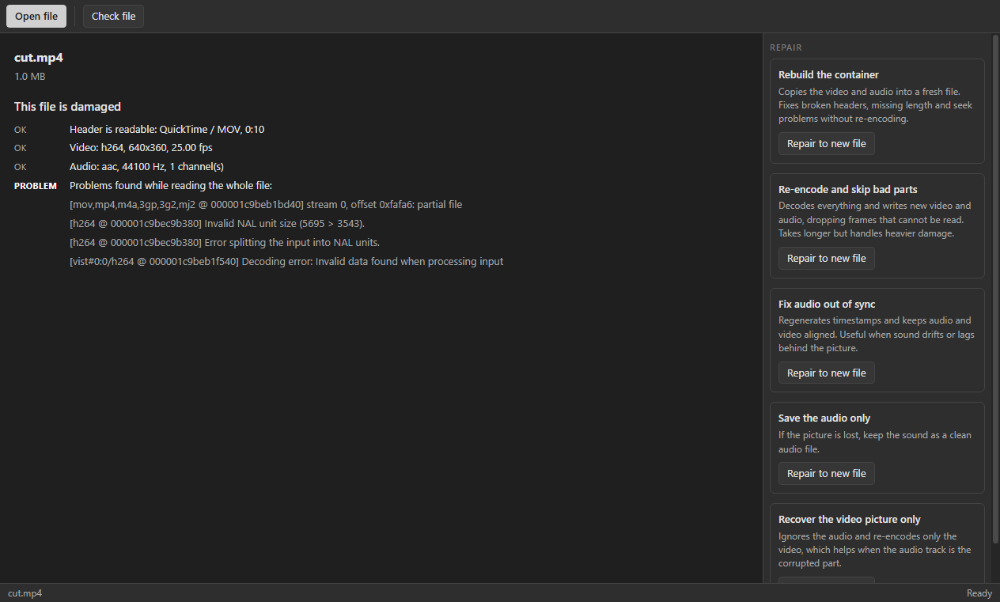</a>

- **Check:** Reads the header, video and audio streams; Decodes the whole file to find hidden errors; Detects a missing length and files cut short
- **Repair:** Rebuild the container without re-encoding; Re-encode and skip bad parts; Fix audio out of sync
- **Safe:** Always writes a new file; The original is only read

<b>All 6 screenshots</b>

**Opening a file.** Choose a damaged file and Mendout shows its name and size.

**The check report.** Mendout reads the whole file and lists what is fine and what is wrong. Here the recording was cut short.

**Repair done.** A repaired copy was saved, with a button to show it in its folder.

**A file that cannot be recovered.** When the header is unreadable the repair buttons stay off instead of pretending.

**A healthy file.** A clean report means nothing needs fixing.

**Output.** A frame from the repaired video.

<b>Every feature</b>

**Check**

- Reads the header, video and audio streams
- Decodes the whole file to find hidden errors
- Detects a missing length and files cut short

**Repair**

- Rebuild the container without re-encoding
- Re-encode and skip bad parts
- Fix audio out of sync
- Save the audio only
- Recover the video picture only

**Safe**

- Always writes a new file
- The original is only read

**Formats:** Common video and audio files such as MP4, MOV, MKV, AVI, WebM, MP3 and WAV.

**[Download Mendout](https://github.com/plawanpawin-byte/mendout/releases/latest)** · [Screenshots and full details](https://github.com/plawanpawin-byte/mendout)

### Tuneout

**Record and edit audio.** Tuneout is an audio editor. See your sound as a waveform, select a part with the mouse, then cut, copy, paste, fade, normalise, filter, change speed or record new audio.

- **Edit:** Cut, copy, paste, delete, trim to selection and silence; Select all, undo and redo
- **Effects:** Fade in and out, normalise, reverse, invert; Gain in decibels; Low cut, high cut, bass and treble boost
- **Speed and pitch:** Half speed, double speed and other presets

<b>All 5 screenshots</b>

**The waveform.** Left and right channels drawn over a time ruler.

**Selecting audio.** Drag across the waveform. The info panel shows the selection and total length.

**Fade and normalise.** Effects apply to the selection, or to everything when nothing is selected.

**Filtering.** Low cut, high cut, bass boost and treble boost at a frequency you choose.

**Saving.** Choose the format and save.

<b>Every feature</b>

**Edit**

- Cut, copy, paste, delete, trim to selection and silence
- Select all, undo and redo

**Effects**

- Fade in and out, normalise, reverse, invert
- Gain in decibels
- Low cut, high cut, bass and treble boost

**Speed and pitch**

- Half speed, double speed and other presets

**Record and generate**

- Record from the microphone
- Insert silence of any length

**View**

- Zoom with the wheel, Fit, Shift + wheel to scroll
- Loop playback

**Files**

- Opens MP3, WAV, FLAC, AAC, M4A, OGG, Opus and even the sound of a video
- Saves MP3, WAV, FLAC, AAC (M4A) and Opus

**Formats:** Opens MP3, WAV, FLAC, AAC, M4A, OGG, Opus, WMA and common video files. Saves MP3, WAV, FLAC, AAC and Opus.

**[Download Tuneout](https://github.com/plawanpawin-byte/tuneout/releases/latest)** · [Screenshots and full details](https://github.com/plawanpawin-byte/tuneout)

## The same everywhere

Every Lookout app follows the same design, so learning one teaches you the rest.

- **Top bar** for files and tools, with a line icon on every button. (PDFout groups its tools into ribbon tabs: Home, Edit, Comment, Form, Organise, Protect, Convert, Tools and View.) On smaller windows, less important buttons shrink to icons; hover to see their names.
- **Left panel** for what you work with (pages, shapes, layers, media). **Right panel** for the settings of what is selected.
- **Status bar** at the bottom with counts, length, zoom or progress.
- **Shortcuts in common:** Ctrl + Z / Ctrl + Y undo and redo, Ctrl + S saves, Ctrl + O opens, Delete removes the selection, Space plays media or pans a canvas, Ctrl + mouse wheel zooms.
- **Undo** for every change, and saving always writes a file you choose.

## What is new

**PDFout 1.0.20 adds passwords** (open and save locked PDFs), a Form tab for fill-in fields and a Word text export. **Pageout is now PDFout**, with a home screen (quick tools, recent and starred files), offline OCR for English and Thai, editing the text of normal PDFs, picture and FDF/XFDF support, Print, Watermark, Page numbers and Export-all-pages-as-images. Every app also now shows its own name and icon in Task Manager and the taskbar instead of "Electron".

Every app now has a new look inspired by Google AI Studio, Colab and Gemini: a calm dark charcoal theme, rounded pill buttons, a soft blue accent and roomier spacing. Each app has a colour logo, shown in the Start menu and in the launcher. Every README was rewritten to explain, in plain words, what the app does, who it is for and how to start. All screenshots were taken again.

## Installing

1. Download the launcher, or the installer of a single app, from its **Releases** page.
2. Run it. Installation is per user and needs no administrator rights.
3. If Windows shows **Windows protected your PC**, click **More info**, then **Run anyway**. The installers are not signed with a paid certificate, which is why this screen appears.
4. Start the app from the Start menu.

Requirements: Windows 10 or 11, 64-bit.

## Removing an app

Use **Remove** in the launcher, or Windows Settings > Apps > Installed apps. Your own files are never deleted.

## Questions

**Are the apps really free?**
Yes. There is no paid tier.

**Do they need internet?**
No. Only the Lookout launcher goes online, and only to look up and download releases from GitHub.

**Where do my files go?**
Wherever you save them. The apps read and write only the files you pick.

**Can I trust the downloads?**
Each launcher download is checked against the checksum published with the release before it runs.

Released under the MIT License.
