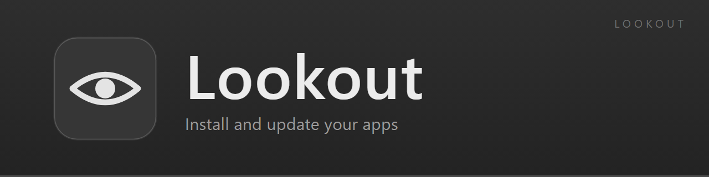
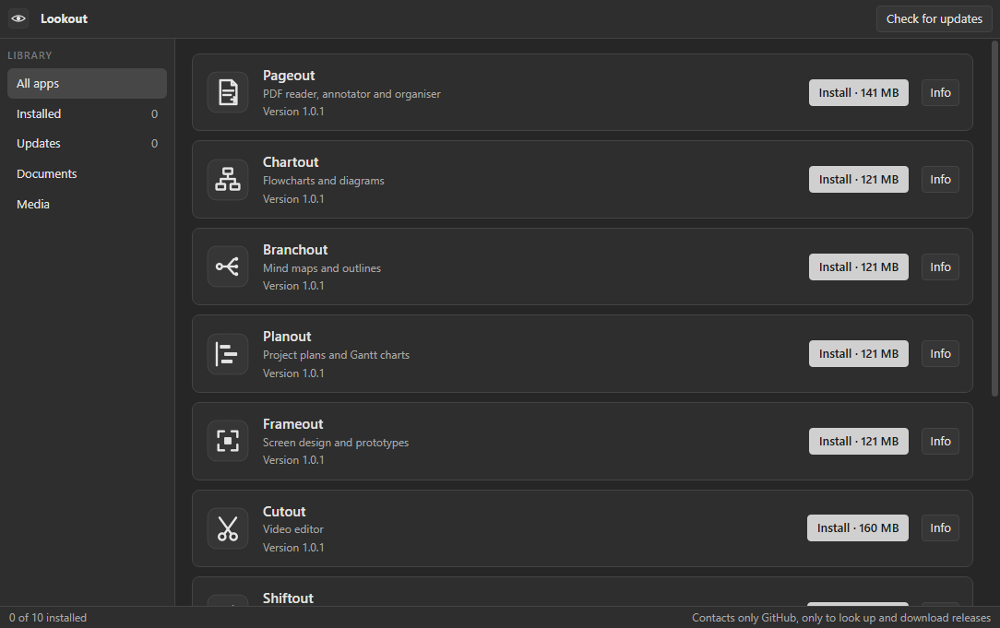
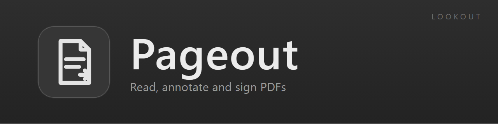
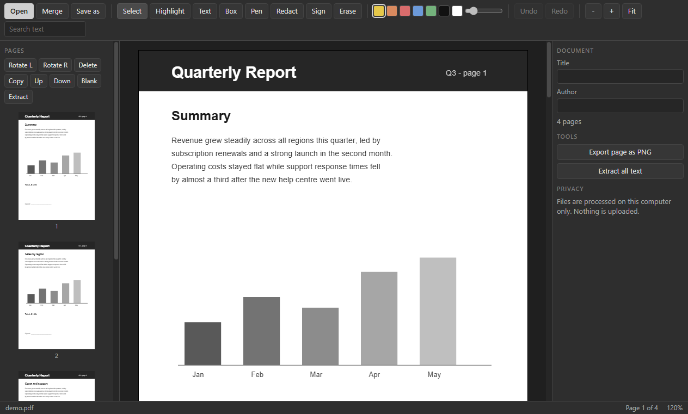
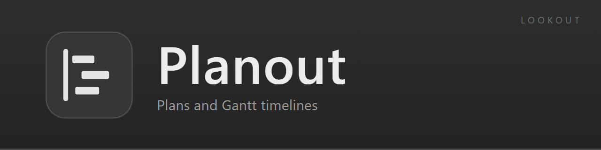
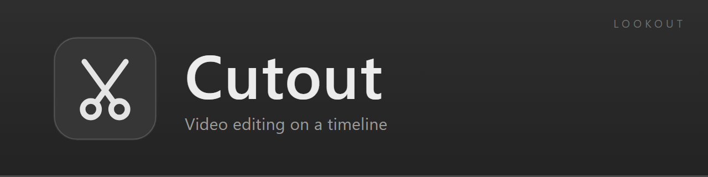
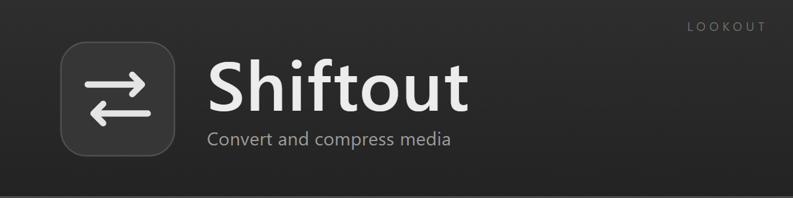
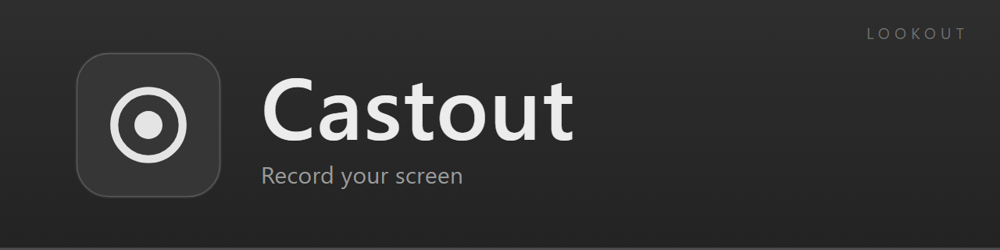
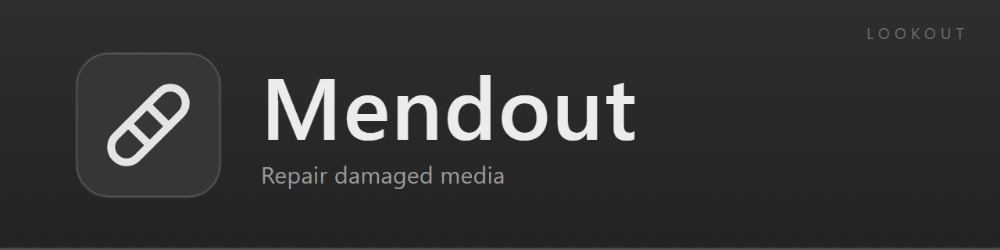

<b>Private, offline apps for Windows</b> Ten apps for documents and media · One launcher · No accounts · No subscriptions · No tracking

---

Lookout is a family of small desktop apps that do the jobs people usually pay a subscription for: reading and signing PDFs, drawing diagrams, planning projects, editing video and audio. They share one calm grey look, they all work without an internet connection, and your files never leave your computer.

## Why Lookout

- **Free and open.** MIT licensed. No trial, no watermark, no upsell.
- **Yours.** No account to create. Nothing is uploaded. Nothing is tracked.
- **Offline.** Every app works with the network switched off. The launcher is the only piece that goes online, only to find and download releases.
- **Calm.** One grey interface, no flashy colour, the same shortcuts and layout from app to app.
- **Safe.** Apps run in locked-down windows and can reach only the files you choose in the Windows file dialogs.

## Start here: the Lookout launcher

Install, open, update and remove all ten apps from one window. **[Download the launcher](https://github.com/plawanpawin-byte/lookout-launcher/releases/latest)** and press **Install** on any app, or pick the apps you want one by one below.

## Documents

### Pageout

**Read, annotate and sign PDFs.** Pageout is a PDF reader and editor for Windows that works entirely on your computer. Open a document, highlight what matters, write notes, draw, sign, black out private details, rearrange pages and save a new copy.

- **Read:** Continuous page view with a thumbnail strip; Zoom, fit to width and quick jumps between pages; Search text across the whole document with every match highlighted
- **Annotate:** Highlighter, free text, rectangle box and freehand pen; Seven ink colours and an adjustable line thickness; Eraser to remove a single mark
- **Sign:** Draw your signature with a mouse, pen or touch screen and place it anywhere on a page; Resize the signature to fit the line

**[Download Pageout](https://github.com/plawanpawin-byte/pageout/releases/latest)** · [Screenshots and full details](https://github.com/plawanpawin-byte/pageout)

### Chartout

**Flowcharts and diagrams.** Chartout is a diagram maker for flowcharts, org charts, process maps and quick sketches of how things connect. Drag shapes onto an unlimited canvas, join them with connectors that follow the shapes around, then export a clean PNG or SVG..

- **Shapes:** Process, rounded, decision, data, ellipse, document, database, subprocess, note, actor, cloud, hexagon, triangle, star and free text; Change fill colour, outline, text and size in the properties panel; Bring a shape to the front or send it back
- **Connectors:** Connect any two shapes; the line follows when you move them; Straight or elbow (right-angle) routing; Optional arrowheads, dashed lines and text labels on every connector
- **Arranging:** Select several shapes with a drag box or Shift + click; Align and distribute horizontally or vertically; Copy, paste and duplicate

**[Download Chartout](https://github.com/plawanpawin-byte/chartout/releases/latest)** · [Screenshots and full details](https://github.com/plawanpawin-byte/chartout)

### Branchout

**Mind maps and outlines.** Branchout is a mind-mapping app. Start with one idea in the centre, branch out with topics and sub-topics, add notes and colour, collapse the parts you are not working on, and turn the whole map into an image or a text outline..

- **Building a map:** Add a child topic or a sibling with a single key; Rename and delete topics; Automatic, balanced layout on both sides of the centre
- **Detail:** Eight soft colours for topics; Notes on any topic; Collapse and expand any branch, or expand everything at once
- **Keyboard first:** Tab adds a child, Enter adds a sibling, F2 edits, Delete removes, Space folds; Arrow keys move the selection around the map

**[Download Branchout](https://github.com/plawanpawin-byte/branchout/releases/latest)** · [Screenshots and full details](https://github.com/plawanpawin-byte/branchout)

### Planout

**Plans and Gantt timelines.** Planout turns a list of tasks into a project plan. Give each task a start date, a length and an owner, link tasks that depend on each other, and watch the Gantt timeline update.

- **Tasks:** Name, start date, length in days, percent done and owner for every task; Add task or milestone, move tasks up and down, delete; Edit directly in the table
- **Dependencies:** Choose which task each task comes after; Start dates move automatically when an earlier task changes; A link that would create a loop is refused
- **Timeline:** Gantt chart with a month and day scale and a today marker; Progress bars, milestone diamonds and dependency arrows; Drag a bar to move it, drag its end to change its length

**[Download Planout](https://github.com/plawanpawin-byte/planout/releases/latest)** · [Screenshots and full details](https://github.com/plawanpawin-byte/planout)

### Frameout

**Screen design and prototypes.** Frameout is a canvas for designing app screens and web pages. Draw a frame for each screen, fill it with rectangles, circles, lines and text, rearrange layers, then export a screen as an image or an SVG.

- **Drawing:** Frame, rectangle, ellipse, line and text tools; Corner radius, fill, outline width and opacity; Font size for text
- **Layers:** A layer list with names, with hide and lock for each layer; Frames hold the objects placed inside them
- **Prototype:** Give a shape a link to a frame; Preview mode lets you click through your screens like a real app

**[Download Frameout](https://github.com/plawanpawin-byte/frameout/releases/latest)** · [Screenshots and full details](https://github.com/plawanpawin-byte/frameout)

## Media

### Cutout

**Video editing on a timeline.** Cutout is a video editor with a multi-track timeline. Import clips, place them in order, split and trim them, add titles and fades, set the volume and speed of each clip, preview the result and export a finished video.

- **Timeline:** Two video tracks and one audio track; Drag to move clips, drag their edges to trim; Split at the playhead, delete, close gaps
- **Clip controls:** Fit or fill the frame; Opacity, volume and playback speed; Fade in and fade out
- **Titles:** Add title text over the picture

**[Download Cutout](https://github.com/plawanpawin-byte/cutout/releases/latest)** · [Screenshots and full details](https://github.com/plawanpawin-byte/cutout)

### Shiftout

**Convert and compress media.** Shiftout converts video and audio between formats, shrinks large files and makes GIFs. Add as many files as you like, choose a target, and convert them all in one go.

- **Targets:** Video: MP4 (H.264), MKV, MOV and WebM (VP9); Animated GIF; Audio: MP3, AAC (M4A), WAV, FLAC and Opus
- **Settings:** Quality presets; Resolution: keep original, 1080p, 720p, 480p or 360p; Frame rate: keep original, 60, 30, 24 or 15
- **Batch:** Convert many files in one run; Stop at any time; Choose the output folder

**[Download Shiftout](https://github.com/plawanpawin-byte/shiftout/releases/latest)** · [Screenshots and full details](https://github.com/plawanpawin-byte/shiftout)

### Castout

**Record your screen.** Castout records your screen or a single window, with computer sound and an optional microphone. Choose what to capture, press start after a short countdown, then review the clip and save it as WebM, MP4, GIF or MP3..

- **Capture:** Any screen or any window; Computer sound and microphone, mixed together; Frame rates from 15 up to 60
- **Control:** Countdown before recording starts; Pause and resume; Stop and review
- **Save:** WebM (fastest, no conversion); MP4 for playing anywhere; GIF (first 30 seconds)

**[Download Castout](https://github.com/plawanpawin-byte/castout/releases/latest)** · [Screenshots and full details](https://github.com/plawanpawin-byte/castout)

### Mendout

**Repair damaged media.** Mendout checks a video or audio file for problems and repairs it into a new file. It explains what it found in plain language and offers fixes that match the damage.

- **Check:** Reads the header, video and audio streams; Decodes the whole file to find hidden errors; Detects a missing length and files cut short
- **Repair:** Rebuild the container without re-encoding; Re-encode and skip bad parts; Fix audio out of sync
- **Safe:** Always writes a new file; The original is only read

**[Download Mendout](https://github.com/plawanpawin-byte/mendout/releases/latest)** · [Screenshots and full details](https://github.com/plawanpawin-byte/mendout)

### Tuneout

**Record and edit audio.** Tuneout is an audio editor. See your sound as a waveform, select a part with the mouse, then cut, copy, paste, fade, normalise, filter, change speed or record new audio.

- **Edit:** Cut, copy, paste, delete, trim to selection and silence; Select all, undo and redo
- **Effects:** Fade in and out, normalise, reverse, invert; Gain in decibels; Low cut, high cut, bass and treble boost
- **Speed and pitch:** Half speed, double speed and other presets

**[Download Tuneout](https://github.com/plawanpawin-byte/tuneout/releases/latest)** · [Screenshots and full details](https://github.com/plawanpawin-byte/tuneout)

## Installing

1. Download the launcher, or the installer of a single app, from its **Releases** page.
2. Run it. Installation is per user and needs no administrator rights.
3. If Windows shows **Windows protected your PC**, click **More info**, then **Run anyway**. The installers are not signed with a paid certificate, which is why this screen appears.
4. Start the app from the Start menu.

Requirements: Windows 10 or 11, 64-bit.

## Questions

**Are the apps really free?**
Yes. There is no paid tier.

**Do they need internet?**
No. Only the Lookout launcher goes online, and only to look up and download releases from GitHub.

**Where do my files go?**
Wherever you save them. The apps read and write only the files you pick.

**Can I trust the downloads?**
Each launcher download is checked against the checksum published with the release before it runs.

Released under the MIT License.
